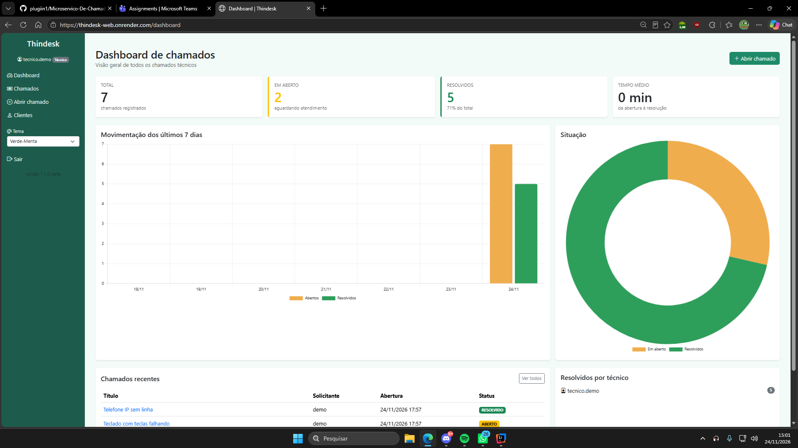

# Microserviço de Chamados Técnicos — ThinDesk

Evolução do **ThinDesk** com a implementação de um **microserviço REST em Java com Spring Boot e MongoDB**, responsável pela **abertura, acompanhamento e resolução de chamados técnicos**.

**Aplicação publicada:** https://thindesk-web.onrender.com — entre com `demo` / `Demo@2026` ou crie sua conta. Detalhes em [Deploy](#deploy).



*Dashboard do ThinDesk em produção, com os indicadores de chamados, a movimentação dos últimos 7 dias, a distribuição por situação e o ranking de técnicos.*

O microserviço reaproveita o **sistema de login já existente**: os mesmos usuários, perfis (`ADMIN`, `TECNICO`, `CLIENTE`) e senhas BCrypt, armazenados no MongoDB Atlas.

## Arquitetura


```
                    ┌──────────────────────────┐
  Navegador ──────► │ thindesk-web  :8080      │  login, cadastro, dashboard,
                    └───┬──────────────────┬───┘  chamados, painel admin, temas
                        │ usa              │ HTTP Basic
                ┌───────▼───────┐          │ (credenciais do usuário logado)
                │   auth-core   │          │
                └───────▲───────┘          │
                        │ usa              │
                    ┌───┴──────────────────▼───┐
  Postman ────────► │ chamados-service :8081   │  API REST de chamados (HTTP Basic)
                    └────────────┬─────────────┘
                                 │
                         ┌───────▼────────┐
                         │ MongoDB Atlas  │  usuarios · chamados · sessoes
                         └────────────────┘
```

| Módulo | Tipo | Responsabilidade |
|---|---|---|
| `auth-core` | biblioteca | Entidade `Usuario`, enum `Role`, `UsuarioRepository`, `UsuarioDetailsService` e `PasswordEncoder` (BCrypt). Compartilhada pelos dois apps |
| `thindesk-web` | app (porta **8080**) | Interface Thymeleaf: login, cadastro, **dashboard e telas de chamados**, painel administrativo de usuários e temas. Consome o microserviço por HTTP |
| `chamados-service` | app (porta **8081**) | **Microserviço** REST de chamados técnicos |

**Como a autenticação é utilizada:** o `chamados-service` depende do `auth-core` e valida as credenciais enviadas por **HTTP Basic** no mesmo `UsuarioDetailsService` usado pelo login web. Um usuário criado ou promovido no ThinDesk web passa a valer na API na hora.

## Interface web

| Tela | Rota | Quem acessa |
|---|---|---|
| **Dashboard** | `/dashboard` | todos. Cliente vê os próprios números; técnico e administrador veem os de toda a operação |
| Lista de chamados | `/chamados` (filtros `?status=ABERTO\|RESOLVIDO`) | todos, com o mesmo recorte por perfil |
| Abertura de chamado | `/chamados/novo` | todos |
| Detalhe e resolução | `/chamados/{id}` | o solicitante vê; técnico e administrador resolvem |
| Gestão de usuários | `/admin/usuarios` | administrador |

O dashboard mostra total, em aberto, resolvidos, percentual de resolução e tempo médio de
atendimento, além de um gráfico de barras com a movimentação dos últimos 7 dias, uma rosca com a
distribuição por situação, os chamados recentes e o ranking de chamados resolvidos por técnico.

**O app web não acessa a coleção de chamados diretamente.** Todas essas telas consomem o
`chamados-service` por HTTP, autenticando com **HTTP Basic** usando as credenciais do usuário
logado, guardadas na sessão no momento do login. Na prática, o navegador fala com o app web, e o
app web fala com o microserviço como se fosse o próprio usuário — as mesmas regras de permissão da
API valem para a interface, sem código duplicado.

## Endpoints

Todos exigem autenticação **HTTP Basic** (usuário e senha do ThinDesk), exceto o `GET /api/info`.

| Método | Rota | Descrição | Quem pode |
|---|---|---|---|
| `POST` | `/api/chamados` | Abrir chamado | Qualquer usuário autenticado |
| `GET` | `/api/chamados` | Listar todos os chamados (filtro opcional `?status=ABERTO\|RESOLVIDO`) | **TECNICO** e ADMIN |
| `GET` | `/api/chamados/usuario/{id}` | Listar chamados de um usuário (filtro opcional `?status=ABERTO\|RESOLVIDO`) | O próprio usuário; TECNICO e ADMIN veem de qualquer um |
| `GET` | `/api/chamados/{id}` | Consultar detalhes e status de um chamado | O solicitante; TECNICO e ADMIN |
| `PUT` | `/api/chamados/{id}/resolver` | Registrar a solução e resolver o chamado | **TECNICO** e ADMIN |
| `GET` | `/api/me` | Dados do usuário autenticado (útil para descobrir o próprio `id`) | Qualquer usuário autenticado |
| `GET` | `/api/info` | Nome do serviço, versão e status (health check) | Público, sem autenticação |

### Abrir chamado

```http
POST /api/chamados
Content-Type: application/json

{
  "titulo": "Computador não liga",
  "descricao": "O computador da recepção não liga desde hoje cedo."
}
```

Resposta **201 Created** (com o cabeçalho `Location: /api/chamados/{id}`):

```json
{
  "id": "6ada41f30257a0431c6e399d",
  "titulo": "Computador não liga",
  "descricao": "O computador da recepção não liga desde hoje cedo.",
  "status": "ABERTO",
  "solicitante": { "id": "6ac6bdfdb9e8476c08645969", "username": "teste_cliente" },
  "dataAbertura": "2026-10-22T17:05:23.512Z"
}
```

### Resolver chamado

```http
PUT /api/chamados/{id}/resolver
Content-Type: application/json

{
  "solucao": "Fonte de alimentação substituída. Computador testado com o usuário."
}
```

Resposta **200 OK**:

```json
{
  "id": "6ada41f30257a0431c6e399d",
  "titulo": "Computador não liga",
  "descricao": "O computador da recepção não liga desde hoje cedo.",
  "status": "RESOLVIDO",
  "solicitante": { "id": "6ac6bdfdb9e8476c08645969", "username": "teste_cliente" },
  "dataAbertura": "2026-10-22T17:05:23.512Z",
  "solucao": "Fonte de alimentação substituída. Computador testado com o usuário.",
  "tecnico": { "id": "6ada3f6d8dce68740ba105f7", "username": "tecnico1" },
  "dataResolucao": "2026-10-22T17:06:10.104Z"
}
```

### Formato de erro

Todos os erros retornam o mesmo formato JSON:

```json
{
  "timestamp": "2026-10-22T17:06:12.881Z",
  "status": 409,
  "erro": "Conflict",
  "mensagem": "Este chamado já foi resolvido e não pode ser alterado.",
  "caminho": "/api/chamados/6ada41f30257a0431c6e399d/resolver"
}
```

Em erros de validação, o campo `campos` traz a mensagem de cada campo inválido.

## Regras de negócio

| Regra | Resposta |
|---|---|
| Solicitante, data de abertura e status `ABERTO` são registrados **automaticamente** pelo sistema. Campos como `status` ou `solicitanteId` enviados no corpo são ignorados | — |
| Título obrigatório, de 5 a 120 caracteres; descrição obrigatória, de 10 a 2000 | `400` |
| Solução obrigatória, de 10 a 2000 caracteres | `400` |
| Apenas **TECNICO** (ou ADMIN) pode resolver chamados | `403` |
| O técnico e a data de resolução são registrados automaticamente a partir do usuário autenticado | — |
| **Chamado resolvido não pode ser alterado novamente** | `409` |
| Dois técnicos resolvendo o mesmo chamado ao mesmo tempo: só o primeiro é gravado (controle de concorrência com `@Version`) | `409` |
| CLIENTE só lista e consulta os **próprios** chamados | `403` |
| Chamado ou usuário inexistente | `404` |
| Requisição sem credenciais ou com senha errada | `401` |

## Versionamento

A versão atual do sistema é **`1.1.0-beta`**. Ela aparece no rodapé do menu lateral do app web e no
endpoint público `GET /api/info` do microserviço, e é a mesma versão declarada no `pom.xml` pai —
os três módulos (`auth-core`, `thindesk-web` e `chamados-service`) são publicados juntos, com um
único número de versão.

O projeto adota o **Versionamento Semântico 2.0.0** ([semver.org](https://semver.org/lang/pt-BR/)),
no formato:

```
MAIOR.MENOR.CORREÇÃO-PRÉ-LANÇAMENTO
  1  .  1  .    0       -    beta
```

| Parte | Quando muda | Exemplo neste projeto |
|---|---|---|
| **MAIOR** (`1`) | Mudança incompatível com a versão anterior: um endpoint removido ou com contrato alterado, ou uma mudança que obrigue a refazer a configuração | Trocar o HTTP Basic por outro esquema de autenticação levaria a `2.0.0` |
| **MENOR** (`1`) | Funcionalidade nova mantendo compatibilidade com quem já usa a versão anterior | O dashboard e o `GET /api/chamados` levaram a versão de `1.0.0` para `1.1.0` |
| **CORREÇÃO** (`0`) | Correção de defeito sem mudar o contrato nem adicionar funcionalidade | Um acerto no cálculo do tempo médio do dashboard geraria `1.1.1` |
| **PRÉ-LANÇAMENTO** (`beta`) | Indica que a versão ainda não é considerada estável para produção | `alpha` → `beta` → versão final sem sufixo |

**Os rótulos de pré-lançamento usados aqui:**

- **`alpha`** — funcionalidade em construção, sujeita a mudanças de contrato a qualquer momento.
- **`beta`** — funcionalidade completa e testada, em validação; o contrato da API já é considerado estável.
- **sem sufixo** (`1.1.0`) — versão estável, pronta para uso em produção.

Pela regra do SemVer, uma versão de pré-lançamento tem precedência **menor** que a versão normal
de mesmo número: `1.1.0-alpha` < `1.1.0-beta` < `1.1.0`.

**Histórico de versões:**

| Versão | Data | Marco |
|---|---|---|
| `1.1.0-beta` | 24/11/2026 | Dashboard e telas de chamados no app web consumindo o microserviço |
| `1.0.0-alpha` | 22/10/2026 | Microserviço REST de chamados (abertura, consulta e resolução) |

O detalhamento de cada versão fica no **[CHANGELOG.md](CHANGELOG.md)**, no formato
[Keep a Changelog](https://keepachangelog.com/pt-BR/1.1.0/). As mensagens de commit seguem o padrão
[Conventional Commits](https://www.conventionalcommits.org/pt-br/) (`feat`, `fix`, `docs`,
`refactor`), o que torna direto decidir se a próxima versão muda a parte MENOR ou a de CORREÇÃO.

## Deploy

A aplicação está publicada no **[Render](https://render.com)**, com os dois serviços rodando em
containers Docker separados e apontando para o mesmo MongoDB Atlas:

| Serviço | URL | Observação |
|---|---|---|
| App web (login e dashboard) | **https://thindesk-web.onrender.com** | é por aqui que se acessa o sistema |
| Microserviço de chamados | **https://thindesk-chamados-service.onrender.com** | API REST; `GET /api/info` responde sem autenticação |

### Credenciais de exemplo

Qualquer pessoa pode entrar com o usuário de demonstração abaixo, ou criar a própria conta em
**/cadastro** (o cadastro cria um usuário com perfil CLIENTE).

| Perfil | Usuário | Senha | O que vê |
|---|---|---|---|
| Cliente | `demo` | `Demo@2026` | dashboard e chamados próprios; pode abrir chamados |
| Técnico | `tecnico.demo` | `Tecnico@2026` | dashboard de todos os chamados; pode resolver |

> **Primeiro acesso demora.** No plano gratuito do Render os serviços hibernam após 15 minutos sem
> uso, e o primeiro acesso leva cerca de um minuto para acordar o container. Como o app web conversa
> com o microserviço, pode ser preciso esperar as duas partidas: se o dashboard demorar, basta
> recarregar a página.

### Como o deploy está montado

Os arquivos de deploy ficam na raiz do repositório:

| Arquivo | Para que serve |
|---|---|
| `Dockerfile.web` | Build em dois estágios do `thindesk-web` (Maven + JDK 21 → imagem só com o JRE) |
| `Dockerfile.chamados` | O mesmo para o `chamados-service` |
| `render.yaml` | *Blueprint* do Render: declara os dois serviços, o plano, o health check e as variáveis de ambiente |
| `.dockerignore` | Impede que `.env`, `target/` e `.git` entrem na imagem |

Em produção, a porta vem da variável `PORT` definida pela plataforma (`server.port=${PORT:8080}`),
o cookie de sessão é marcado como `secure` e o cache do Thymeleaf fica ligado.

### Reproduzindo o deploy

1. No **MongoDB Atlas**, em *Network Access*, libere `0.0.0.0/0` — o Render não tem IP fixo no plano gratuito.
2. No Render, clique em **New → Blueprint** e aponte para este repositório. O `render.yaml` cria os dois serviços.
3. Preencha as variáveis marcadas como secretas em cada serviço:

   | Serviço | Variáveis |
   |---|---|
   | `thindesk-chamados-service` | `MONGODB_URI` |
   | `thindesk-web` | `MONGODB_URI`, `ADMIN_USERNAME`, `ADMIN_EMAIL`, `ADMIN_PASSWORD`, `CHAMADOS_API_URL` |

4. Suba primeiro o `thindesk-chamados-service`. Quando ele ficar **Live**, copie a URL pública dele
   e informe em `CHAMADOS_API_URL` no `thindesk-web` (sem barra no final), salvando com
   *Save, rebuild and deploy*. Dentro do container, `localhost` é o próprio serviço — apontar para
   `http://localhost:8081` faz o dashboard responder **503**.
5. Confirme que `GET /api/info` do microserviço responde com a versão, e faça login no app web.

> **Atenção à ordem de criação do administrador.** O administrador é criado na **primeira** execução
> em um banco vazio, com a `ADMIN_PASSWORD` daquele ambiente. Se você rodar o app local apontando
> para o mesmo banco antes do deploy, o admin nasce com a senha do `.env` local e a variável do
> Render é ignorada.

## Tecnologias

| Tecnologia | Versão |
|---|---|
| Java | 21+ |
| Spring Boot (Web, Security, Data MongoDB, Validation) | 3.5.6 |
| Spring Session MongoDB (app web) | gerenciado pelo Boot |
| Thymeleaf | 3.1 / 3.4.0 |
| Lombok | gerenciado pelo Boot |
| MongoDB Atlas | cluster M0 (gratuito) |

## Pré-requisitos

- **JDK 21 ou superior** (`java -version`)
- Uma conta no **[MongoDB Atlas](https://www.mongodb.com/cloud/atlas)**
- **[Postman](https://www.postman.com/downloads/)** (ou Insomnia) para testar a API

O Maven não precisa estar instalado: o projeto inclui o Maven Wrapper (`mvnw` / `mvnw.cmd`).

## Configuração

### MongoDB Atlas

1. Crie um cluster **M0 (Free)**.
2. Em *Security → Database Access*, crie um usuário de banco (de preferência com papel `readWrite` no banco `thindesk`).
3. Em *Security → Network Access*, libere o seu IP.
4. Em *Connect → Drivers → Java*, copie a string de conexão e troque `<db_password>` pela senha, sem os `<` `>`.

O banco e as coleções são criados automaticamente na primeira execução.

### Arquivo `.env`

As credenciais **não ficam no código**. Os dois apps leem um arquivo `.env` na **raiz do projeto** (ignorado pelo Git):

```bash
# Windows (PowerShell)
Copy-Item .env.example .env
# Linux / macOS
cp .env.example .env
```

| Variável | Obrigatória | Descrição | Padrão |
|---|:-:|---|---|
| `MONGODB_URI` | ✅ | String de conexão do Atlas | — |
| `MONGODB_DATABASE` | | Nome do banco | `thindesk` |
| `ADMIN_USERNAME` / `ADMIN_EMAIL` | | Administrador inicial | `admin` / `admin@thindesk.local` |
| `ADMIN_PASSWORD` | ✅ | Senha do administrador inicial | — |
| `CHAMADOS_PORT` | | Porta do microserviço | `8081` |
| `CHAMADOS_API_URL` | | URL do microserviço usada pelo app web | `http://localhost:8081` |
| `PORT` | | Porta imposta pela hospedagem; tem precedência sobre as portas acima | — |
| `LOG_LEVEL` / `THYMELEAF_CACHE` | | Nível de log e cache de templates | `DEBUG` / `false` |
| `SESSION_TIMEOUT` / `COOKIE_SECURE` | | Sessão do app web | `30m` / `false` |
| `APP_NOME` / `APP_TEMA` | | Nome e tema do app web | `Thindesk` / `padrao` |

¹ Usada apenas na primeira execução do `thindesk-web` **em um banco vazio**, para criar o
administrador. Se o usuário `admin` já existir, a variável é ignorada.

> **Cuidado com variáveis de ambiente do sistema.** No Spring, uma variável de ambiente do sistema
> operacional tem **precedência sobre o arquivo `.env`**. Se existir um `MONGODB_URI` definido no
> Windows (ou exportado no shell), é ele que vale, e as mudanças no `.env` passam despercebidas.
> Para conferir o que o app realmente está usando:
>
> ```powershell
> [Environment]::GetEnvironmentVariable('MONGODB_URI','User')   # vazio = o .env está valendo
> ```

## Executando

Rode os dois apps (cada um em um terminal):

```bash
# Microserviço de chamados → http://localhost:8081
.\mvnw.cmd -pl chamados-service -am compile spring-boot:run

# App web (login, dashboard, chamados, painel admin) → http://localhost:8080
.\mvnw.cmd -pl thindesk-web -am compile spring-boot:run
```

Suba o microserviço **primeiro**: o dashboard do app web depende dele. Com a API fora do ar, as
telas de chamados respondem **503** com a mensagem de que não foi possível falar com o
microserviço.

No Linux/macOS, use `./mvnw` no lugar de `.\mvnw.cmd`.

**Pela IDE (IntelliJ):** recarregue o Maven e execute as classes `com.pfc.ThindeskApplication` (módulo `thindesk-web`) e `com.pfc.ChamadosServiceApplication` (módulo `chamados-service`).

**Gerando os jars:**

```bash
.\mvnw.cmd clean package
java -jar thindesk-web/target/thindesk-web-1.1.0-beta.jar
java -jar chamados-service/target/chamados-service-1.1.0-beta.jar
```

## Testando com o Postman

A coleção pronta está em **[`docs/postman/ThinDesk-Chamados.postman_collection.json`](docs/postman/ThinDesk-Chamados.postman_collection.json)**.

1. No Postman, clique em **Import** e selecione o arquivo.
2. A coleção já vem com as credenciais de demonstração (`demo` e `tecnico.demo`) nas variáveis
   `clienteUser`, `clientePass`, `tecnicoUser` e `tecnicoPass`.
3. Para testar **contra o deploy**, troque a variável `baseUrl` da coleção de
   `http://localhost:8081` para `https://thindesk-chamados-service.onrender.com`. Para testar local,
   cadastre os dois usuários em http://localhost:8080/cadastro e promova o técnico, como `admin`,
   em http://localhost:8080/admin/usuarios.
4. Execute as requisições **na ordem numerada** (1 → 11). Elas guardam o `id` do usuário e do chamado criado nas variáveis `usuarioId` e `chamadoId`, e cada uma tem testes automáticos que aparecem na aba **Test Results**.

| # | Requisição | Esperado |
|---|---|---|
| 1 | Quem sou eu (cliente) | `200` + salva `usuarioId` |
| 2 | Abrir chamado | `201` + status `ABERTO` + salva `chamadoId` |
| 3 | Abrir chamado inválido | `400` |
| 4 | Listar chamados do usuário | `200` |
| 5 | Consultar chamado | `200` |
| 6 | Resolver como cliente | `403` |
| 7 | Resolver chamado (técnico) | `200` + status `RESOLVIDO` |
| 8 | Resolver novamente | `409` |
| 9 | Consultar chamado resolvido | `200` |
| 10 | Listar apenas resolvidos | `200` |
| 11 | Sem autenticação | `401` |

A coleção também roda pela linha de comando com o Newman:

```bash
npx newman run docs/postman/ThinDesk-Chamados.postman_collection.json
```

## Persistência no MongoDB

Os chamados ficam na coleção **`chamados`** do banco `thindesk`:

```json
{
  "_id": "ObjectId('6ada41f30257a0431c6e399d')",
  "titulo": "Computador não liga",
  "descricao": "O computador da recepção não liga desde hoje cedo.",
  "status": "RESOLVIDO",
  "solicitanteId": "6ac6bdfdb9e8476c08645969",
  "solicitanteUsername": "teste_cliente",
  "dataAbertura": "ISODate('2026-10-22T17:05:23.512Z')",
  "solucao": "Fonte de alimentação substituída. Computador testado com o usuário.",
  "tecnicoId": "6ada3f6d8dce68740ba105f7",
  "tecnicoUsername": "tecnico1",
  "dataResolucao": "ISODate('2026-10-22T17:06:10.104Z')",
  "versao": 1
}
```

- `solicitanteId` e `tecnicoId` referenciam o `_id` da coleção `usuarios`, a mesma do sistema de login.
- Há um índice em `solicitanteId` para a listagem por usuário.
- `versao` é o controle de concorrência otimista (`@Version`).

## Estrutura do projeto

```
├── pom.xml                         # pom pai (módulos e versões)
├── auth-core/                      # autenticação compartilhada
│   └── com/pfc/auth/{entity,repository,service,config}
├── thindesk-web/                   # app web (porta 8080)
│   └── com/pfc/{auth,ui,thindesk}
├── chamados-service/               # microserviço (porta 8081)
│   └── com/pfc/chamados/
│       ├── config/                 # SecurityConfig (HTTP Basic, stateless)
│       ├── controller/             # ChamadoController, UsuarioController, InfoController
│       ├── dto/                    # requisições, respostas e formato de erro
│       ├── entity/                 # Chamado, StatusChamado
│       ├── exception/              # exceções e ApiExceptionHandler
│       ├── repository/             # ChamadoRepository
│       └── service/                # ChamadoService (regras de negócio)
├── thindesk-web/.../chamados/      # consumo do microserviço pelo app web
│   ├── client/                     # ChamadosApiClient (RestClient) e credenciais na sessão
│   ├── controller/                 # telas de dashboard, lista, abertura e resolução
│   ├── dto/                        # espelho das respostas da API e formulários
│   └── service/                    # DashboardService (indicadores e séries dos gráficos)
├── Dockerfile.web                  # imagem do app web
├── Dockerfile.chamados             # imagem do microserviço
├── render.yaml                     # blueprint do deploy no Render
├── CHANGELOG.md                    # histórico de versões
└── docs/
    ├── ESTRUTURA.md                # estrutura e decisões de design
    ├── ROTEIRO-VIDEO.md            # roteiro da demonstração em vídeo
    ├── images/                     # print do dashboard
    └── postman/                    # coleção do Postman
```

Mais detalhes sobre a estrutura e as decisões de design em **[docs/ESTRUTURA.md](docs/ESTRUTURA.md)**.
